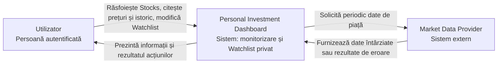
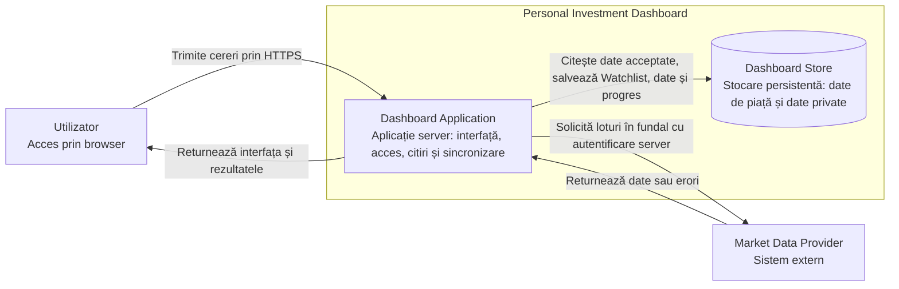
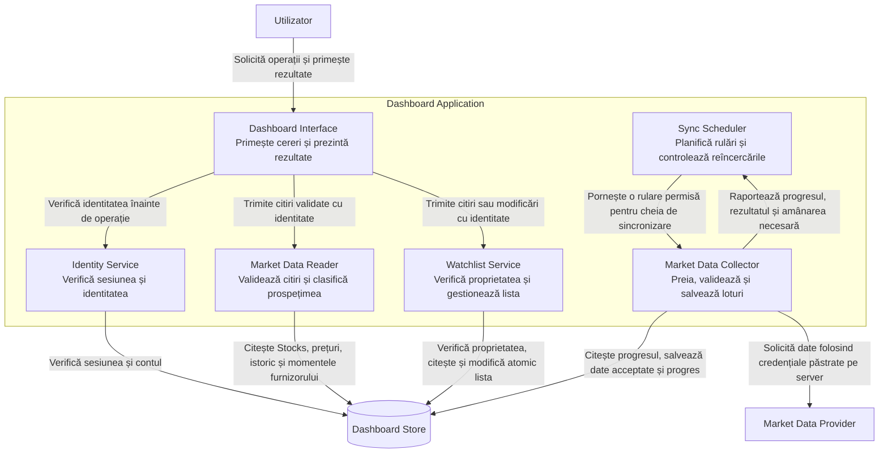
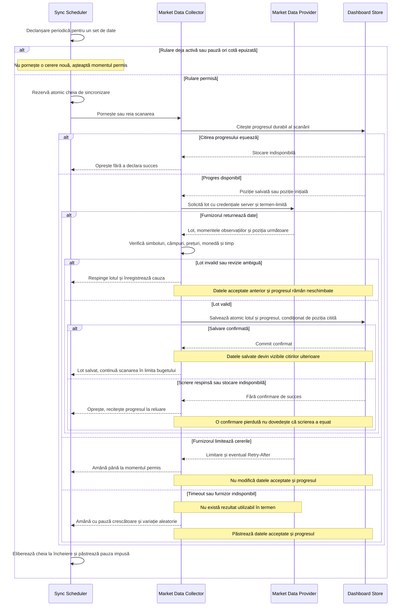
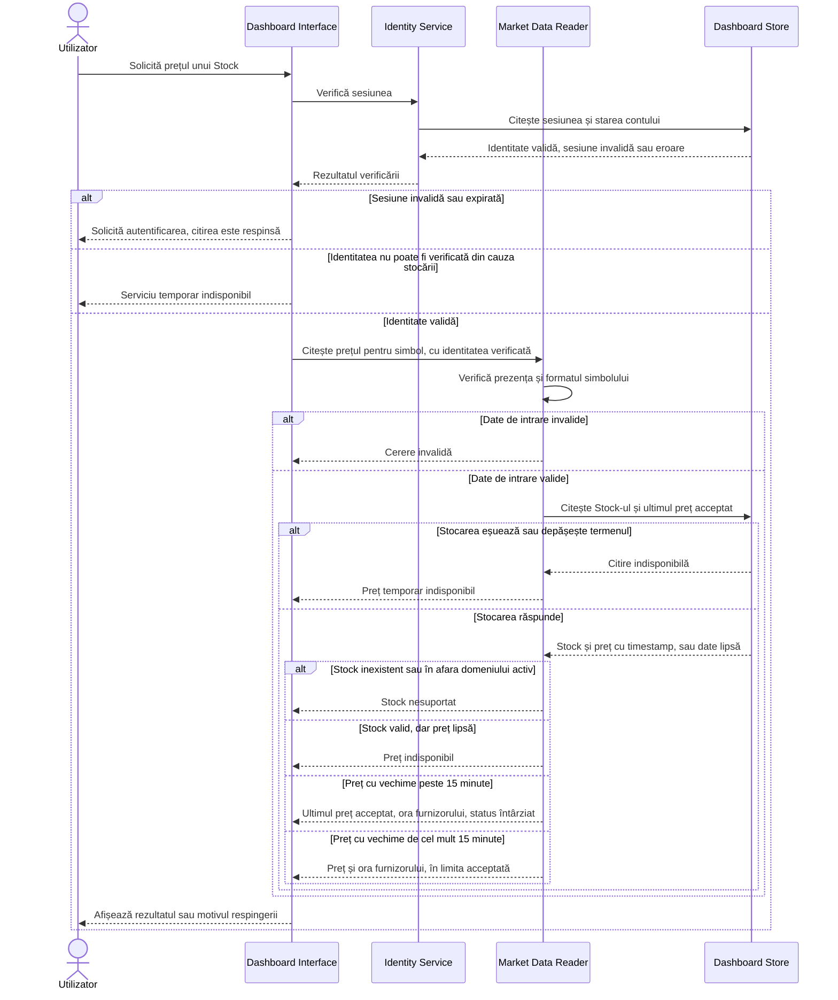
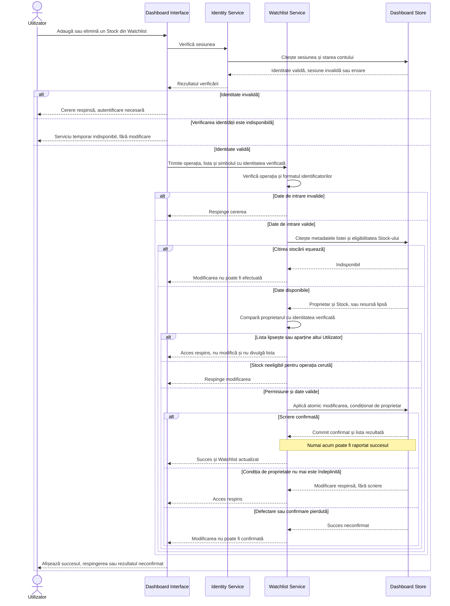

# Laboratorul 3 — Desenează limita Dashboard-ului

**Produs:** Personal Investment Dashboard  
**Scop:** definirea limitelor arhitecturii și verificarea comportamentului prin fluxuri normale, respingeri și defectări.

Un Utilizator autentificat poate răsfoi și filtra Stocks, citi prețuri și istoric și administra un Watchlist privat. Market Data Provider furnizează date întârziate și poate returna date invalide, poate limita cererile sau poate fi indisponibil. Dashboard-ul monitorizează informațiile și nu execută tranzacții.

## Cerințe și ipoteze de proiectare

Utilizăm datele de lucru din laboratorul 2:

| Indicator | 300 Utilizatori | 3.000 Utilizatori | 30.000 Utilizatori |
|---|---:|---:|---:|
| Citiri în regim stabil | 79,2 RPS | 792 RPS | 7.920 RPS |
| Stock price în regim stabil | 60 RPS | 600 RPS | 6.000 RPS |
| Subtotal la deschiderea pieței | 93,6 RPS | 936 RPS | 9.360 RPS |
| Țintă cu marja de 10%, rotunjită în sus | 103 RPS | 1.030 RPS | 10.296 RPS |

Aceste valori reprezintă cereri către Dashboard, nu către furnizor. Stock price produce aproximativ 75,8% din traficul stabil, ceea ce justifică reutilizarea datelor acceptate și stocate.

| Cerință | Decizie pentru laboratorul 3 |
|---|---|
| Latență | p95 ≤ 2 s pentru citiri; suplimentar, p50 ≤ 500 ms pentru Stock price |
| Disponibilitate | Folosim opțiunea relaxată din secțiunea 1.2.1 a Lab 2: 99% în orele de tranzacționare și 98% în restul timpului |
| Prospețime | Vechime ≤ 15 minute: preț în limita acceptată; peste 15 minute: preț afișat explicit ca întârziat |
| Date lipsă | Rezultat „indisponibil”, niciodată preț inventat sau înlocuit cu zero |
| Watchlist privat | Identitate verificată și acces numai pentru proprietar |
| Consistență Watchlist | Următoarea citire după succes reflectă modificarea confirmată: read-your-writes |
| Date de piață | Aproximativ 5.700 Stocks; istoric la intervale de 5 minute, conform ipotezelor Lab 2 |

Alegem **sincronizarea exclusiv în fundal**, o alternativă discutată în Lecția 4. Citirile Utilizatorului nu declanșează și nu așteaptă sincronizarea. Avantajul este eliminarea latenței furnizorului de pe traseul citirii; costul este că datele lipsă sau vechi nu pot fi actualizate imediat la cerere.

Limita de 15 minute se calculează folosind momentul observației furnizorului, nu momentul descărcării. Sincronizarea frecventă nu elimină întârzierea furnizorului. Dacă acesta livrează deja observații vechi de aproximativ 15 minute, unele rezultate vor depăși limita și vor fi marcate corespunzător.

Diagramele folosesc notația Mermaid pentru view-uri C4: dreptunghiurile reprezintă sisteme, aplicații sau componente, conform etichetei; cilindrul reprezintă stocarea; contururile marchează limitele. Săgețile au etichete care explică interacțiunea. În secvențe, săgețile continue reprezintă cereri, iar cele întrerupte reprezintă rezultate.

## 1. Diagrama System Context

Sistemul este prezentat ca o singură unitate. Utilizatorul și Market Data Provider sunt în afara limitei; nu sunt afișate părți interne.

Limita sistemului este caseta **Personal Investment Dashboard**. Autentificarea este gestionată în interiorul produsului; nu presupunem un furnizor extern de identitate. Nu introducem brokeri sau sisteme de plată, deoarece acestea nu fac parte din domeniul produsului.

## 2. Diagrama Container

Alegem două containere C4: o aplicație server și o stocare. Interfața web este generată de Dashboard Application și accesată prin browser; nu presupunem o aplicație frontend implementată și lansată separat.

| Container | Responsabilitate și date |
|---|---|
| Dashboard Application | Prezintă interfața, verifică identitatea și accesul, execută citirile, modifică Watchlist și sincronizează datele în fundal |
| Dashboard Store | Păstrează conturi și sesiuni, proprietatea și conținutul Watchlist-urilor, datele de referință Stock, latest price, price history, daily summary și progresul sincronizării |

Colectorul este o responsabilitate internă a aplicației, nu un proces separat. Astfel, prima versiune are un set mic de părți de execuție. Această alegere reduce costul administrării, dar sincronizarea și citirile împart resursele aplicației. Limităm numărul loturilor procesate simultan și bugetul de lucru al sincronizării pentru a proteja citirile.

Dashboard Store este stocarea autoritativă pentru Watchlist. Scrierile sunt atomice, iar citirile ulterioare folosesc starea confirmată. Tehnologia concretă rămâne nedecisă; aceste proprietăți trebuie verificate la implementare.

Capacitatea de **10.296 RPS** este o țintă de validat, nu o proprietate demonstrată de diagramă. Stocarea comună și procesul aplicației sunt puncte de defectare pentru prima versiune. Extinderea sau separarea colectorului se justifică ulterior prin măsurători, dacă soluția minimă nu respectă țintele.

## 3. Diagrama Component

Deschidem numai **Dashboard Application**. Toate cele șase componente din contur aparțin aceleiași aplicații și nu sunt servicii lansate separat. Dashboard Store și Market Data Provider rămân în exteriorul acestui contur.

| Componentă | Responsabilitate |
|---|---|
| Dashboard Interface | Primește cererile din browser, solicită verificarea identității, direcționează operația și afișează rezultatul normal, respingerea sau indisponibilitatea |
| Identity Service | Verifică existența, valabilitatea și expirarea sesiunii și returnează identitatea verificată; o eroare de stocare nu este tratată ca autentificare reușită |
| Market Data Reader | Acoperă Overview, Filter, Search, Stock price și History; verifică parametrii și citește exclusiv date acceptate; calculează vechimea prețului |
| Watchlist Service | Verifică parametrii și proprietatea, gestionează adăugarea/eliminarea și citirea privată; poate citi prețurile acceptate pentru Stocks din listă |
| Sync Scheduler | Pornește periodic sincronizarea, împiedică suprapunerile pentru aceeași cheie și respectă cota, pauzele și momentul permis al reîncercării |
| Market Data Collector | Reunește coordonarea loturilor, comunicarea cu furnizorul, validarea și scrierea sigură prezentate în exemplul detaliat din Lecția 4 |

Datele private sunt accesate numai după verificarea identității. Identificatorul proprietarului este obținut din sesiunea verificată, nu acceptat ca identitate declarată de browser. Pentru Watchlist, verificarea proprietății este obligatorie atât la citire, cât și la modificare.

## 4. Diagrame de secvență

### A. Sincronizează datele de piață

**Ipoteze inițiale și reguli:**

- Există un singur proces Dashboard Application activ în această variantă. Scheduler-ul este intern; cheia de sincronizare identifică furnizorul, setul de date și domeniul lotului. Mai multe instanțe ar necesita coordonare comună înainte de activarea sincronizării pe ele.
- Propunem verificarea scadențelor o dată pe minut. Frecvența apelurilor efective respectă actualizarea și cota furnizorului: latest price are prioritate, History păstrează punctele de 5 minute, datele de referință se actualizează zilnic, iar daily summary după sesiune. Verificarea periodică nu înseamnă o cerere per Stock în fiecare minut.
- Ca ipoteză operațională inițială, un apel către furnizor are timeout de 5 s. Sunt permise cel mult trei încercări pentru același lot într-o rulare, cu pauze crescătoare și variație aleatorie; `Retry-After` prevalează dacă impune o așteptare mai mare. Declanșările periodice nu ocolesc pauza.
- Credențialele furnizorului sunt păstrate în configurația protejată a serverului și sunt accesibile colectorului. Nu ajung în browser sau în mesaje de eroare și jurnale.
- Validarea verifică Stock-ul și domeniul acceptat, câmpurile obligatorii, un preț numeric finit și pozitiv, moneda USD și timestamp-ul. Ca ipoteză, respingem observații cu mai mult de 60 s în viitor; datele vechi pot fi valide, dar vor fi etichetate la citire.
- Respingem întregul lot dacă o înregistrare este invalidă. Înregistrăm cauza pentru corectare; nu reluăm rapid și repetat un lot invalid.
- Latest price este înlocuit numai de o observație mai nouă, printr-o condiție verificată în scriere. O observație identică nu produce efect suplimentar. History are o identitate stabilă: Stock, interval și momentul furnizorului. Valori diferite cu același timestamp sunt tratate ca revizii ambigue, respinse și semnalate pentru clarificare.
- Datele și progresul se salvează atomic. Dacă se pierde confirmarea, următoarea rulare recitește progresul: dacă a avansat, continuă; dacă nu, repetă sigur lotul; dacă stocarea rămâne indisponibilă, se oprește. O eroare de furnizor nu șterge datele acceptate anterior.
- Diagrama detaliază un lot. Scanarea continuă cu următoarele loturi și este declarată completă numai după salvarea ultimului. Următoarea scanare programată are propria poziție inițială; un cursor expirat determină reluarea de la o poziție validă, cu aceleași reguli de deduplicare.
- Momentul furnizorului, momentul preluării și ultima scanare completă reușită se păstrează distinct. Numai primul determină vechimea prețului afișat.

### B. Citește prețul unui Stock

**Ipoteze inițiale și reguli:**

- Utilizatorul trimite o sesiune și un simbol. Sesiunea poate să fi expirat, chiar dacă interfața era deja deschisă; verificarea se repetă pentru fiecare cerere protejată.
- Toți Utilizatorii autentificați pot citi datele de piață din domeniul acceptat. Formatul simbolului este verificat înainte de interogare, iar existența și eligibilitatea se verifică folosind catalogul stocat.
- Vechimea este `momentul curent − momentul observației furnizorului`. Ceasurile serverului sunt sincronizate. Eticheta „în limita acceptată” nu înseamnă preț în timp real.
- **Citirea nu are nevoie de o cerere nouă către Market Data Provider.** Lipsa datelor și depășirea limitei nu declanșează o sincronizare la cerere.
- Pentru date mai vechi de 15 minute, alegem alternativa permisă în laborator 2: afișăm ultimul preț acceptat, timestamp-ul și eticheta vizibilă „întârziat”. După închiderea pieței, aceeași regulă se aplică; timestamp-ul nu este actualizat artificial.
- O defectare a stocării nu este confundată cu un preț lipsă. Nu avem în această variantă o copie alternativă de unde să garantăm citirea.
- Aplicația aplică un termen total de 2 s, cu bugete interne pentru verificarea identității și citire, și rezervă timp pentru răspuns. Țintele p50/p95 se verifică prin măsurători; setarea unui timeout nu garantează singură atingerea lor.

### C. Modifică un Watchlist privat

**Ipoteze inițiale și reguli:**

- Watchlist-ul există pentru un proprietar; identificatorul listei transmis de browser nu conferă acces. Verificăm autentificarea, datele de intrare și proprietatea înainte de modificare.
- Adăugarea cere un Stock activ din domeniul acceptat. Eliminarea unui Stock deja prezent este permisă și după delistarea acestuia, pentru a putea curăța lista.
- Proprietatea este verificată din nou în condiția scrierii atomice, pentru a evita o modificare neautorizată dacă starea se schimbă între verificare și scriere.
- Adăugarea unui Stock deja prezent și eliminarea unuia deja absent păstrează starea dorită fără dubluri. Aceste operații pot fi repetate sigur; o confirmare pierdută nu este prezentată ca dovadă că modificarea nu s-a produs.
- Succesul este raportat numai după confirmarea stocării. Interfața nu afișează anticipat o modificare drept definitivă.
- **Următoarea citire reușită a aceluiași Utilizator, începută după confirmare, trebuie să includă modificarea**, dacă nu a intervenit între timp o altă modificare confirmată. Traseul este Dashboard Interface → Identity Service → Watchlist Service → Dashboard Store, cu verificările de identitate și proprietate repetate.
- Citirea folosește stocarea autoritativă, fără o copie întârziată sau un cache privat în această variantă. Dacă stocarea nu poate fi citită, rezultatul este „indisponibil”, nu un Watchlist vechi prezentat ca actual.

## Verificarea proiectării în raport cu cerințele

| Cerință sau risc | Acoperire în proiectare | Verificare ulterioară la implementare |
|---|---|---|
| Cele șase citiri din Lab 2 | Market Data Reader acoperă cinci citiri; Watchlist Service acoperă lista privată | Testarea mixului de trafic din Lab 2, inclusiv History și filtre cu rezultate voluminoase |
| Până la 10.296 RPS | Datele acceptate sunt reutilizate; o citire nu generează un apel la furnizor | Test de încărcare la 103, 1.030 și 10.296 RPS, cu sincronizarea activă, urmărind p50/p95, erorile și resursele |
| Date invalide, vechi sau lipsă | Validare înainte de scriere și verificarea prospețimii la citire | Lot invalid, observație repetată, preț lipsă și preț mai vechi de 15 minute |
| Furnizor indisponibil sau limitare | Timeout, pauze controlate și păstrarea datelor acceptate | Simularea limitării și a indisponibilității fără multiplicarea cererilor |
| Date private | Identitate verificată și proprietate controlată la fiecare acces | Utilizatorul A încearcă citirea și modificarea listei Utilizatorului B |
| Read-your-writes | Confirmare după commit și citire din starea autoritativă | Modificare confirmată urmată imediat de citire |
| Stocare indisponibilă | Rezultat explicit; nicio confirmare falsă de succes | Defectare la citirea identității, prețului, proprietății și la scriere |
| Reluarea sincronizării | Date și progres atomice, deduplicare și scrieri condiționate | Oprire după commit, dar înaintea confirmării; reluare fără dubluri |
| Disponibilitate 99% / 98% | Dependența de furnizor este eliminată de pe traseul citirilor | Măsurarea separată a celor două intervale; răspunsurile rapide de eroare nu dovedesc disponibilitatea funcțională |

Estimarea de aproximativ 4,96 GiB din Lab 2 privește datele de piață brute în modelul său de retenție. Nu reprezintă dimensiunea totală a Dashboard Store: conturile, sesiunile, Watchlist-urile, progresul, indexurile și copiile de siguranță necesită o estimare separată. Diagramele definesc responsabilitățile și proprietățile necesare; nu demonstrează capacitatea sau disponibilitatea unei implementări.

## Listă de verificare

- [x] Am inclus o diagramă System Context, una Container și una Component.
- [x] Am inclus cele trei diagrame de secvență cerute.
- [x] Toate cele șase blocuri Mermaid se afișează fără erori (verificate prin randare).
- [x] Diagrama Component deschide numai Dashboard Application.
- [x] Fluxurile arată rezultate normale, acțiuni respinse și rezultate în caz de defectare.
- [x] Proiectarea acoperă citirile normale, datele private, preluarea datelor de la furnizor și defectările.
- [x] Numele participanților sunt consecvente între view-uri și secvențe.
- [x] Ipotezele inițiale și regulile sunt precizate sub fiecare diagramă de secvență.
- [x] Sunt folosite țintele de volum din Lab 2 și varianta de disponibilitate 99% / 98%.
- [x] Credențialele furnizorului rămân pe server, iar succesul scrierii este raportat numai după confirmare.
